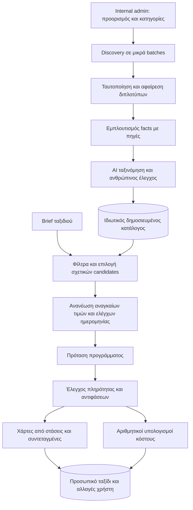

# Trippy: κοινή βάση προορισμών και έρευνα ανά ταξίδι

Ημερομηνία: 28 Οκτωβρίου 2026. Πρόταση αρχιτεκτονικής και εφαρμοσμένες διορθώσεις στο υπάρχον pipeline. Η βάση και το web admin δεν έχουν ακόμη εγκατασταθεί.

## Απόφαση

Προτείνεται ιδιωτικός κατάλογος προορισμών σε PostgreSQL, με κοινή έρευνα ανά κατηγορία/περιοχή. Πάνω σε αυτόν δημιουργείται ξεχωριστό, προσωπικό ταξίδι με ελέγχους ημερομηνιών, προσφορές/τιμές, επιλογή στάσεων, πρόγραμμα και κόστη. Δεν αποθηκεύουμε ένα τεράστιο generated JSON ως «αλήθεια» για μια πόλη.

Ο χρήστης βλέπει μία ενέργεια δημιουργίας ταξιδιού. Εσωτερικά, η συλλογή δεδομένων, η επιβεβαίωση, η κατάταξη, η σύνθεση και οι υπολογισμοί έχουν διαφορετικές ευθύνες.

## Τι έδειξε το πραγματικό τελευταίο αποτέλεσμα

Το τελευταίο διαθέσιμο πλήρες αποτέλεσμα Barcelona περιέχει 7 μέρη: 4 αξιοθέατα και 3 επιλογές φαγητού. Έχει 5 ημέρες, αλλά όλες με μηδέν στάσεις· μηδέν συντεταγμένες, μηδέν map views, μηδέν μεταφορές και μηδέν events. Οι επιλεγμένες κατηγορίες μουσείων, αγορών και εκδρομών δεν καλύπτονται. Υπάρχουν 4 επιλογές εισιτηρίων, 5 booking tasks και 11 sources, αλλά κανένα ουσιαστικό συνολικό σενάριο κόστους.

Αυτό δεν είναι πρωτίστως πρόβλημα εμφάνισης χαρτών. Ο web scout ζητούσε μόνο τέσσερα αξιοθέατα και τρία εστιατόρια. Η σύνθεση έλαβε ανεπαρκή έρευνα και άφησε σωστά πολλά facts άγνωστα, αλλά δεν διαχώρισε μια προτεινόμενη διαδρομή από μια επιβεβαιωμένη κράτηση. Τα warnings παραδέχονται ότι δεν ερευνήθηκαν πολλές ενότητες. Το λεπτομερές prompt της χειροκίνητης εφαρμογής δεν τροφοδοτούσε το API pipeline.

Το πλήρες αποτέλεσμα και ο αναλυτικός έλεγχός του κρατήθηκαν τοπικά στον εξαιρούμενο από Git φάκελο `recovered-research/`. Δεν αποτελούν δημοσιευμένο dataset.

## Διορθώσεις που έγιναν τώρα

- Κοινό contract και κοινά prompts στο `research_pipeline.py`/`research_contract.json`, για backend και developer script. Αποφεύγεται η προηγούμενη απόκλιση πλήρους JSON και patch.
- Ο scout λαμβάνει όλο το brief και ζητά κάλυψη ανά επιλεγμένη κατηγορία, περιοχή και ενότητα, περιλαμβάνοντας γεωγραφικά facts και στοιχεία για σύνθεση.
- Το synthesis διαχωρίζει `proposed` πρόγραμμα από πραγματική διαθεσιμότητα. Άγνωστο κατάλυμα ή ηλικίες δεν ακυρώνουν κάθε ημέρα του προγράμματος.
- Τα map views παράγονται από τις στάσεις με σταθερά IDs και την πραγματική σειρά τους. Δεν δημιουργούνται συντεταγμένες, διαδρομές δρόμου ή χρόνοι από εικασίες.
- Έλεγχος τύπων, συνδέσεων, διπλών IDs, ημερών, συντεταγμένων και επιλεγμένων κατηγοριών. Κενά οδηγούν σε `quality_report.status=partial`, όχι σε αδήλωτη επιτυχία. `ready` σημαίνει επαρκή δομική κάλυψη, όχι εγγύηση ότι όλα τα facts είναι επίκαιρα.
- Η εφαρμογή εμφανίζει τις ελλείψεις. Οι άγνωστες ημερομηνίες δεν αντικαθίστανται κρυφά με ημερομηνίες Ρώμης.
- Το developer script δημιουργεί prompts χωρίς API κλήσεις, εκτός αν δοθεί ρητά `--execute`.

Οι αλλαγές βελτιώνουν το επόμενο run. Δεν πρόσθεσαν καινούργια ερευνητικά facts στο ήδη παραχθέν Barcelona αποτέλεσμα και δεν έτρεξαν αυτόματες χρεώσιμες επαναλήψεις. Η σημερινή παραγωγή παραμένει ένα scout + ένα synthesis· δεν έχει ακόμη το πλήρες σύστημα shared catalog/retrieval.

## Επίπεδο Α: κοινός κατάλογος προορισμού

### Κάλυψη

Ξεχωριστές κατηγορίες: αξιοθέατα/αρχιτεκτονική, μουσεία/γκαλερί, γειτονιές/βόλτες, εστιατόρια, καφέ, bars, clubs, αγορές, parks/beaches, δραστηριότητες, οικογενειακές επιλογές και εκδρομές. Τα bars δεν συγχέονται με όλα τα tapas restaurants.

Κάθε εργασία καλύπτει μία κατηγορία σε συγκεκριμένη περιοχή, με στόχο π.χ. 10–20 νέους candidates και συγκεκριμένο όριο κόστους. Οι αριθμοί είναι στόχοι ανακάλυψης, όχι ελάχιστα που πρέπει να συμπληρωθούν με εικασίες. Μετά ενώνουμε τις εργασίες και αφαιρούμε διπλότυπα βάσει ταυτότητας και διεύθυνσης, όχι μόνο ονόματος.

Για το πιλοτικό Barcelona, αρχική επιθυμητή κάλυψη είναι δεκάδες επιλογές ανά σημαντική κατηγορία, με διαφορετικές περιοχές και price bands. Δεν ξεκινάμε με στόχο «όλα τα μέρη» ή μη ελεγχόμενο bulk scraping. Τα events είναι χρονικά records, όχι μόνιμα facts μιας πόλης.

### Εκδρομές και φύση

Ο προορισμός έχει σχέσεις με κοντινούς προορισμούς/activities, π.χ. Montserrat, Girona, παράκτιες περιοχές ή διαδρομές φύσης. Κάθε εκδρομή έχει ανεξάρτητη ταυτότητα, πρόσβαση/επιστροφή, εποχικότητα, διαδρομές, απαιτούμενη διάρκεια, walking effort, weather dependencies και κόστος μεταφοράς/εισιτηρίων. Οι σχετικές πληροφορίες ελέγχονται από πηγές· η πρόταση εδώ δεν αποτελεί επιβεβαίωση χρόνων ή τιμών.

Μία εκδρομή μπορεί να συνδέεται με περισσότερες πόλεις βάσης. Δεν αντιγράφεται ολόκληρη ως νέο μέρος για κάθε πόλη. Η εμφάνισή της ενεργοποιείται από ενδιαφέροντα και διαθέσιμο χρόνο· δεν αντικαθιστά αυτόματα μια ημέρα πόλης.

### Facts, εκτιμήσεις και user state

Κάθε σημαντικό πεδίο κρατά τιμή, μονάδα/βάση, source IDs, πραγματικό χρόνο retrieval, τρόπο ελέγχου, confidence, ισχύ και κατάσταση `confirmed / candidate / unknown / stale / disputed`. `checked_at` δεν γράφεται από το μοντέλο απλώς επειδή γνωρίζει τη σημερινή ημερομηνία.

Ο AI ταξινομητής δημιουργεί πολλαπλές, όχι αποκλειστικές, βαθμολογίες: family, friends, couple, solo, partying, culture, nature, accessibility και value. Κάθε score συνοδεύεται από αιτιολογία και evidence, ή επισημαίνεται ως editorial/model estimate.

Χωρίζουμε:

| Πεδίο | Ερμηνεία |
|---|---|
| `min_age`, επίσημο maximum group size, ticket eligibility | Κανόνας φορέα, χρειάζεται πηγή. |
| `suggested_group_size`, typical visit duration | Σύσταση/εκτίμηση, όχι εγγύηση χωρητικότητας. |
| `recommended_trip_days` | Heuristic προτεραιότητας: π.χ. μια ολόκληρη εκδρομή έχει μικρότερο βάρος σε πολύ σύντομο city trip. |
| Per-person price range | Συγκεκριμένη βάση, νόμισμα, πηγή, ημερομηνία· διακριτό από εκτίμηση budget. |
| Like, avoid, edited time, προσωπική κράτηση | Ανήκει στον χρήστη, ποτέ δεν αντικαθίσταται από refresh του catalog. |

Άγνωστη αλλεργιολογική ή προσβασιμότητας πληροφορία δεν μετατρέπεται σε «ασφαλές/κατάλληλο». Αν τα constraints είναι κρίσιμα, η επιλογή απαιτεί επιπλέον έλεγχο ή αποκλείεται από τις επιβεβαιωμένες προτάσεις.

## Επίπεδο Β: προσωπικό ταξίδι και φρέσκοι έλεγχοι

1. Εφαρμόζουμε hard filters και προτεραιότητες στο δημοσιευμένο catalog.
2. Ανακτούμε μικρό candidate set, π.χ. 20–50 κατάλληλα records και τα αναγκαία source facts, όχι όλη τη βάση μέσα στο prompt.
3. Ελέγχουμε μόνο αναγκαία stale/volatile facts για την ακριβή ημερομηνία: λειτουργία, εποχικές αλλαγές, εισιτήρια, διαθέσιμα slots, events, διαδρομές/μεταφορές.
4. Ο planner προτείνει πρόγραμμα με τις verified constraints και με ρητά provisional στοιχεία. Άγνωστη ώρα άφιξης σημαίνει ευέλικτο arrival day.
5. Validator απορρίπτει κλειστούς χώρους στο κύριο πλάνο, λάθος ημερομηνίες, ανεπαρκείς συνδέσεις και αντιφάσεις. Ανεπαρκής έρευνα γίνεται στοχευμένο repair task, όχι γενική επανεκκίνηση.
6. Χάρτες παράγονται για κάθε προτεινόμενη ημέρα και δραστηριότητα/τμήμα, από IDs και coordinates. Routing provider παράγει πραγματικά legs/διάρκεια· μια γραμμή στον χάρτη δεν είναι απόδειξη διαδρομής δρόμου.
7. Κανονικός αριθμητικός κώδικας υπολογίζει per-person/group subtotals, eligible tickets, quantities, taxes/fees όπου είναι γνωστά και unknown categories. Δεν ζητάμε από το LLM να είναι calculator.

Τα events/future ticket slots δεν μπορούν να είναι πλήρη για όλες τις μελλοντικές ημερομηνίες. `not_found` σημαίνει αποτέλεσμα συγκεκριμένου ελέγχου, όχι υπόσχεση ότι δεν υπάρχει event.

## Refresh και οικονομία

Ενδεικτική πολιτική εκκίνησης, όχι εγγύηση ενημέρωσης:

- Ταυτότητα/διεύθυνση/κατηγορία: ανανέωση σε αραιότερα διαστήματα και όταν υπάρχει αλλαγή/αναφορά.
- Ωράρια, τιμές, όροι εισιτηρίων: μικρότερο TTL ανά πηγή και επανέλεγχος όταν χρησιμοποιούνται σε ταξίδι.
- Events/διαθεσιμότητα/διακοπές λειτουργίας: συχνότερος έλεγχος σε date windows, και νέα επίσημη επιβεβαίωση πριν από πραγματική κράτηση.
- Refresh μόνο των μεταβλημένων πεδίων. Διατηρείται ιστορικό και δεν χάνεται η προηγούμενη εγγραφή όταν μια πηγή προσωρινά δεν απαντά.

Η τρέχουσα προσέγγιση κοστίζει περίπου `N × πλήρης_έρευνα` για N χρήσεις. Ο κατάλογος κοστίζει `seed + κοινά_refresh + N × (ανάκτηση + στοχευμένος_έλεγχος + σύνθεση)`. Συμφέρει όταν η επανάχρηση ξεπερνά το αρχικό και συνεχιζόμενο κόστος. Για ένα μόνο σύντομο ταξίδι, ένας τεράστιος κατάλογος μπορεί να είναι ακριβότερος. Για επαναλαμβανόμενες αναζητήσεις, εναλλακτικές ή πολλούς χρήστες, η απόσβεση είναι πιθανότερη.

Δεν δίνουμε ποσοστό εξοικονόμησης χωρίς πραγματικά token/search/infra measurements. Τα budgets αφορούν requests, input/output tokens, τυχόν search/tool charges και storage/hosting. Σταματάμε batch πριν περάσει το budget· επαναλαμβάνεται μόνο failed/incomplete module. Η αποστολή ολόκληρου του καταλόγου σε κάθε prompt ακυρώνει μεγάλο μέρος της οικονομίας.

Μια «τελευταία ταξινόμηση» γίνεται ανά batch και μετά υπάρχει merge/review. Δεν ξαναστέλνουμε χιλιάδες πλήρη records για συνολική επεξεργασία κάθε φορά.

## Database και αποθήκευση

Για αρχικό πιλοτικό προτείνεται managed PostgreSQL και managed authentication, π.χ. Supabase, με backend στο υπάρχον Render. Πρόκειται για επιλογή προς υλοποίηση, όχι provisioned υπηρεσία. Free tiers είναι χρήσιμα για δοκιμή με όρια· δεν τα θεωρούμε δωρεάν παραγωγή χωρίς περιορισμούς. Το filesystem ενός ephemeral service δεν είναι μόνιμη βάση δεδομένων.

Βασικοί πίνακες:

| Σύνολο | Ενδεικτικά records |
|---|---|
| Γεωγραφία | `destinations`, `areas`, `destination_links`, geospatial coordinates/polygons. |
| Catalog | `places`, `activities`, `excursions`, place/activity relations, provider IDs. |
| Facts | `sources`, `field_claims`, `operating_rules`, `ticket_products`, `price_observations`, classification scores. |
| Χρόνος | `events`, dated exceptions, `date_verifications`, quote validity windows. |
| Publishing | `research_jobs`, `module_runs`, coverage targets, proposals/diffs, dataset versions, audit log, usage ledger. |
| Χρήστης | `trips`, preferences, selected stops, bookings, user edits και per-trip cost inputs. |

Indexes σε destination/category/status, coordinates, fact freshness και entity/date. Vector search είναι προαιρετικό αργότερα· δεν απαιτείται για το πρώτο πιλοτικό και δεν αντικαθιστά τα hard filters.

## Admin account, GitHub και κρυπτογράφηση

Ναι, το web internal tool χρειάζεται admin λογαριασμό. Χρησιμοποιούμε managed login με password και MFA, περιορισμένη πρόσβαση και server-validated admin role. Δεν γράφουμε κοινό password στο frontend ούτε δημιουργούμε δικό μας πρόχειρο σύστημα αποθήκευσης passwords. Ο ρόλος δεν μπαίνει σε client-editable user metadata.

- Το GitHub περιέχει κώδικα, schemas/migrations, prompts και συνθετικά fixtures. Ο live κατάλογος, τα research snapshots, οι χρήστες, τα ταξίδια, secrets και backups δεν μπαίνουν σε public repo.
- Η βάση βρίσκεται σε ιδιωτική managed υπηρεσία με TLS, ελεγχόμενα permissions, κρυπτογράφηση σε αποθήκευση όπου υποστηρίζεται/ρυθμίζεται και ασφαλή αντίγραφα με ξεχωριστή διαχείριση κλειδιών.
- Εφαρμόζουμε row-level permissions: ο χρήστης διαβάζει μόνο δικά του ταξίδια και τις δημοσιευμένες επιλογές που επιτρέπεται να εκτεθούν. Admin writes επιτρέπονται μόνο σε εξουσιοδοτημένους λογαριασμούς. Service-role keys μένουν στο backend.
- Το API επιστρέφει τα αναγκαία records, όχι database credentials ή ολόκληρο dump.
- Κρυπτογραφημένο αρχείο στο public GitHub δεν προσφέρει μυστικότητα αν το κλειδί είναι μέσα στην εφαρμογή. Κρυπτογράφηση δεν αντικαθιστά authentication/authorization, ούτε εμποδίζει νόμιμους clients να δουν δεδομένα που τους δίνουμε.
- Το σημερινό bridge **δεν** έχει production user isolation/authentication. Έχει κοινό in-memory result, ενώ `TRIPPY_BRIDGE_TOKEN` δεν εφαρμόζεται. Δεν το μετατρέπουμε σε δημόσιο admin tool. Χρειάζονται owner-scoped jobs/status, persistent storage, authentication, authorization, rate/cost limits και atomic job claiming πριν από δημόσια χρήση.

## Πηγές και δικαιώματα

Επίσημες σελίδες φορέων/τουρισμού/μεταφορών για λειτουργία και τιμές· OSM ή άλλα επιτρεπόμενα γεωγραφικά δεδομένα για ταυτότητα/θέση· Nager.Date/επίσημες αρχές για αργίες· επίσημα event calendars· Wikimedia/φωτογραφίες με επιβεβαιωμένη άδεια για media.

«Βρέθηκε δημόσια στο web» δεν σημαίνει ότι επιτρέπεται απεριόριστη αντιγραφή, αποθήκευση reviews/ratings ή αναδημοσίευση φωτογραφιών. Κάθε provider έχει source policy: permitted fields, attribution, caching/retention, quotas και επιτρεπόμενη αναδιανομή. Δεν χρησιμοποιούμε Google/Tripadvisor ή άλλους καταλόγους σαν δωρεάν bulk export χωρίς να έχουν ελεγχθεί οι όροι.

Πρωτογενείς αναφορές για τη φάση υλοποίησης:

- [Supabase Auth](https://supabase.com/docs/guides/auth) και [Row Level Security](https://supabase.com/docs/guides/database/postgres/row-level-security).
- [OpenStreetMap copyright/licensing](https://www.openstreetmap.org/copyright), [Nominatim usage policy](https://operations.osmfoundation.org/policies/nominatim/) και [tile usage policy](https://operations.osmfoundation.org/policies/tiles/).
- [Nager.Date](https://date.nager.at/) και [Wikimedia Commons reuse](https://commons.wikimedia.org/wiki/Commons:Reusing_content_outside_Wikimedia).

## Internal εργαλείο: συγκεκριμένο workflow

Dashboard ανά destination με coverage matrix και counts, όχι μόνο πράσινο «completed». Επιλογή κατηγορίας, περιοχής, batch size, source policy και budget πριν από run. Κάθε job έχει modules που μπορούν να παύσουν/συνεχιστούν ή να επαναληφθούν ανεξάρτητα. Δεν ξαναρχίζει όλο το destination όταν αποτύχει μία περιοχή.

Ο admin βλέπει candidate records, duplicates/identity conflicts, πηγές ανά πεδίο, άγνωστα/παλιά facts, usage και diff από την προηγούμενη έκδοση. Εγκρίνει συγκεκριμένες αλλαγές και δημοσιεύει version. Προηγούμενη έκδοση παραμένει διαθέσιμη για rollback. Failed ή unpublished records δεν περνούν αυτόματα στην εφαρμογή.

Refresh queues ενεργοποιούνται από TTL, αλλαγή πηγής, αναφορά χρήστη ή upcoming travel dates. Νέα location προστίθεται με νέο discovery batch και μπορεί να συνδεθεί με υπάρχουσες εκδρομές. Ένα terminal developer tool μπορεί να προηγηθεί του web UI· όταν εκτελείται αποκλειστικά τοπικά, η πρόσβαση προστατεύεται από OS/server credentials, όχι από public admin form.

## Σειρά υλοποίησης

1. **Τώρα:** audit πραγματικού output, κοινά prompts/contract, deterministic maps, coverage flags και κανένα αυτόματο billable retry.
2. **Barcelona pilot:** ιδιωτικό PostgreSQL, normalized tables, source/field provenance, versioning· local job planner ανά κατηγορία/περιοχή, budgets και ελεγχόμενα paid runs.
3. **Publishing και retrieval:** review queue, canonical deduplication, bounded candidate retrieval και freshness-aware checks, έξοδος συμβατή με το iOS contract.
4. **Private web admin:** managed auth/MFA, protected roles, coverage/usage UI, scheduling και targeted refresh.
5. **Trip overlay:** price/date checks, constraint planner, routing και deterministic cost calculations με user ownership.
6. **Επέκταση:** περισσότεροι προορισμοί και linked excursions όταν έχουν περάσει τους ίδιους ποιοτικούς ελέγχους.

Αποδοχή πιλοτικού: η επιλεγμένη κατηγορία έχει πραγματικές διαφορετικές επιλογές και sources, published records έχουν ελεγχόμενη ταυτότητα, κάθε itinerary day συνδέεται με τις πραγματικές στάσεις/χάρτη, unknown costs δεν εμφανίζονται ως μηδενικά, τα refresh δεν καταστρέφουν user edits και η επανάχρηση μετριέται σε πραγματικό usage.
