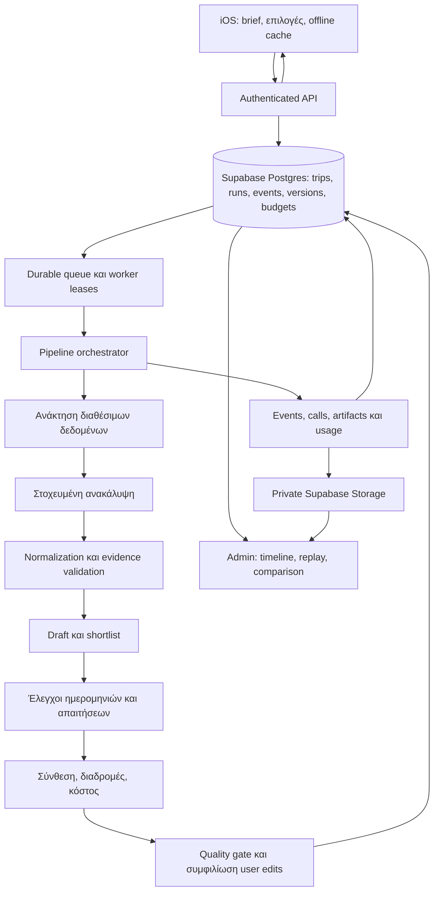

# Trippy: αρχιτεκτονική plans, troubleshooting και αλλαγών pipeline

3 Νοεμβρίου 2026. Σχέδιο υλοποίησης, όχι ολοκληρωμένη σύνδεση με Supabase ή deployment.

## 1. Απόφαση και πραγματική αφετηρία

Κάθε πλάνο πρέπει να συνδέεται μόνιμα με την εκτέλεση που το δημιούργησε. Κάθε
εκτέλεση πρέπει να εξηγεί τι ζητήθηκε, τι δεδομένα χρησιμοποιήθηκαν, ποιες κλήσεις
έγιναν, τι επέστρεψαν, τι απορρίφθηκε, πόσο κόστισε και τι τελικά παρουσιάστηκε.
Αυτό αποτελεί λειτουργία του προϊόντος και υποδομή ανάπτυξης μαζί.

Σήμερα υπάρχουν δύο διαδρομές που δεν έχουν ενοποιηθεί:

| Διαδρομή | Υπάρχει | Κενό |
|---|---|---|
| Ενεργό iOS → `bridge_server.py` → `planner/pipeline.py` | Πραγματικός provider, τοπικά stages/receipts, progress, εισαγωγή πλάνου | Προσωρινά αρχεία Render, χωρίς cloud συγχρονισμό ταξιδιών ή πλήρες admin ιστορικό |
| Backend `/v2` | Trips/decisions, jobs, events, idempotency, leases/fencing, budgets και settlement | Fake-provider runtime· ο worker απορρίπτει paid adapters και το αποτέλεσμα είναι proposals, όχι πλήρες plan |

Επαναχρησιμοποιούμε τη δεύτερη υποδομή και συνδέουμε τον planner με αυτήν. Δεν
θεωρούμε ότι η ύπαρξη πινάκων ή unit tests πιστοποιεί ενεργή cloud λειτουργία.
Το schema και τα δικαιώματα του πραγματικού Supabase project χρειάζονται live audit.

Η αρχική τοπολογία είναι ένας modular Python backend, μία ξεχωριστή worker
διεργασία και το Supabase για μόνιμα δεδομένα. Τα modules είναι όρια κώδικα και
contracts· δεν δημιουργούμε ξεχωριστό microservice για κάθε βήμα.



## 2. Φιλοσοφία και όρια ευθύνης

- Η έρευνα δημιουργεί επιλογές. Ο χρήστης επιλέγει, αποκλείει, κλειδώνει και αλλάζει το ταξίδι.
- Οι πηγές στηρίζουν facts. Οι υπολογισμοί ανήκουν στην εφαρμογή. Το μοντέλο δεν πιστοποιεί ωράρια, συντεταγμένες ή κόστος με δική του δήλωση.
- Η απλή οθόνη χρήστη δείχνει αποτέλεσμα, πρόοδο και σαφή επόμενη ενέργεια. Η αναλυτική εσωτερική πληροφορία βρίσκεται σε support/admin προβολές.
- Κάθε επιλογή, στάση, πηγή και απόφαση έχει σταθερή ταυτότητα. Tabs, χάρτες και πίνακες διαβάζουν το ίδιο μοντέλο πλάνου.
- Το αποθηκευμένο πλάνο, η νέα πρόταση και οι αλλαγές του χρήστη είναι διακριτές εκδόσεις. Μια νέα έρευνα δεν αντικαθιστά σιωπηλά κλειδώματα και χειροκίνητες αλλαγές.
- Unknown, stale, disputed και estimated είναι καταστάσεις δεδομένων. Δεν μετατρέπονται σε verified επειδή ολοκληρώθηκε ένα job.

## 3. Modules και συμβόλαια

| Module | Είσοδος → έξοδος | Ευθύνη / επαναχρησιμοποίηση |
|---|---|---|
| Brief | Trip revision → immutable `BriefSnapshot` | Typed ημερομηνίες, ομάδα, preferences, constraints, anchors και scopes. Επέκταση `planning_contract.py`. |
| Research scope | Brief + coverage policy → `ResearchTaskGraph` | Ποιες κατηγορίες/πεδία λείπουν, dependencies, στόχοι και όρια. Εξαγωγή του `task_matrix` από τον orchestrator. |
| Retrieval | Tasks + evidence versions → `EvidenceBundle` | Κοινός κατάλογος, προσωπικά saves, διαθέσιμα facts, freshness και provenance. Επέκταση `research_context.py`. |
| Providers | Typed request + limits → `ProviderReceipt` | Ένα μόνο σημείο για web, Luna και μελλοντικούς adapters. Δεν παράγουν τελικό itinerary ούτε γράφουν user decisions. |
| Normalization | Receipt + schema → `ResearchBatch` | Parsing, schema checks και εξαγωγή. Τα evidence checks έχουν ξεχωριστό αποτέλεσμα από το parsing. |
| Identity/evidence | Batches → `EvidenceGraph` | Matching ακριβούς branch, deduplication, contradictions, source references. Εξαγωγή από `merge_batches`. |
| Ranking/shortlist | Evidence + preferences → scored candidates | Αιτιολόγηση επιλογής/απόρριψης, diversity, γεωγραφία και hard exclusions. |
| Date/constraint checks | Shortlist + dates → `CheckResults` | Ωράρια, εξαιρέσεις, απαιτήσεις και πραγματικές ανάγκες ελέγχου. |
| Composition | Candidates + checks + anchors → `PlanDraft` | Ημέρες, χρονικά παράθυρα, buffers, σειρά και εναλλακτικές. Εξαγωγή από `compose_plan`. |
| Routes | Ordered stops + mode → `RouteResult` | Provider route ή σαφώς επισημασμένη εκτίμηση. Ταυτότητα stops και σωστή σειρά. |
| Costs | Items + party + currencies → `CostBreakdown` | Βάση τιμής, ποσότητες, subtotal, άγνωστα κόστη και υποθέσεις. |
| Validation | Draft + coverage policy → `ValidationReport` | Structural, coverage, feasibility και evidence checks· όχι ένας ενιαίος γενικός έλεγχος. |
| Publishing/reconciliation | Draft + expected revision → `PlanVersion` | Διατήρηση user edits, version conflict, ατομική δημοσίευση και συγχρονισμός. |
| Orchestrator | Task graph → run outcome | Εκτελεί dependencies, checkpoints και πολιτικές failure/retry. Δεν περιέχει prompts ή SQL κάθε domain. |

Κοινό envelope για κάθε stage:

```text
StageRequest:
  run_id, stage_id, attempt_id, input_artifact_refs, input_hash,
  contract_version, implementation_version, policy_version, limits

StageResult:
  status, output_artifact_refs, counts_in, counts_out,
  rejected_counts_by_reason, gaps, validation_report_ref,
  provider_call_refs, usage_refs, error_code, elapsed_ms
```

Τα payloads παραμένουν συγκεκριμένα typed contracts. Ένα γενικό `dict` δεν
αντικαθιστά το `ResearchBatch` ή το `PlanDraft`. Το σημερινό `ProviderResult`
του `/v2` δεν χωρά πλήρες plan: προσθέτουμε διακριτό versioned plan αποτέλεσμα,
χωρίς να χαλαρώσουμε το υπάρχον proposal contract.

## 4. Μόνιμη αποθήκευση και συσχέτιση

Επεκτείνουμε το υπάρχον μοντέλο με additive migrations. Τα released schema
snapshots παραμένουν αμετάβλητα.

| Record | Βασικά στοιχεία |
|---|---|
| `trips` / user decisions | Owner, revision, ενεργή plan version, πλήρες brief και private overlay. |
| `research_jobs` ως run root | Trip/revision, support ID, parent run, scope, pipeline manifest, outcome και timestamps. |
| Νέα `research_steps` | Stable stage identity, dependencies, input/output hashes, state και μετρήσεις. |
| Νέα `step_attempts` | Ξεχωριστή εγγραφή για κάθε retry/repair/re-execution· ποτέ overwrite προηγούμενης αποτυχίας. |
| Νέα `provider_calls` | Dispatch identity, provider/model/deployment, request limits, response ID, HTTP status, receipt refs και usage state. |
| Υπάρχοντα `job_events` | Αύξων cursor και versioned, redacted payload. Reconnect από το τελευταίο event που διάβασε το κινητό. |
| Νέα `artifact_refs` | Private object path, content hash, schema, byte size, owner, retention και upload state. |
| Νέα `plan_versions` | Immutable generated result, evidence refs, validation και originating run. |
| Changes / validation reports | Γιατί άλλαξε μια στάση/τιμή/διαδρομή, ποιο user lock διατηρήθηκε και τι εκκρεμεί. |
| Υπάρχοντα budgets/usage | Επέκταση σε ανά-call reservations/settlement και σύνδεση με run, stage και owner. |

Αλυσίδα που πρέπει να λειτουργεί πάντα:

```text
user → trip → trip revision → run → stage → attempt → provider call
                                                  → receipt → usage
               run → plan version → app-applied revision
```

Το support ID δεν είναι credential. Ο χρήστης διαβάζει τα δικά του records μέσω
authenticated API. Το admin διαβάζει traces και artifacts με server-side role
checks και καταγραφή πρόσβασης. Δεν βασιζόμαστε σε ένα μη μαντεύσιμο UUID για
την εξουσιοδότηση. Private Storage και ownership/RLS ελέγχονται μαζί.

Το κινητό κρατά cache και pending local edits. Server acknowledgement σημαίνει
ότι το πλάνο δημοσιεύτηκε στη βάση· η τοπική αποθήκευση και το cloud sync έχουν
διακριτές ενδείξεις. Το run ID μένει συνδεδεμένο με την plan version μετά την
ολοκλήρωση, χωρίς να θεωρείται πλέον ενεργό αίτημα.

Οι SQL transactions παραμένουν σύντομες· δεν κρατάμε row locks όσο περιμένουμε
ένα μοντέλο. State transitions και τα αντίστοιχα events γράφονται στην ίδια
transaction. Storage upload και SQL commit δεν είναι μία κοινή transaction:
χρησιμοποιούμε idempotent artifact writes με hashes, upload state και outbox/
repair εργασία. Ένα required artifact που λείπει εμποδίζει το downstream stage
και καταγράφεται ως storage failure, όχι ως failure του μοντέλου.

## 5. Τι καταγράφουμε σε κάθε σημείο

1. **Αρχή run:** πλήρες immutable brief, revisions, task graph, versions, όρια και πολιτική diagnostic capture.
2. **Retrieval:** ποιες πηγές/records ήταν διαθέσιμα, ποια ανακτήθηκαν, ποια απορρίφθηκαν και γιατί. Catalog version και freshness ανά πεδίο.
3. **Prompt:** template version, rendered request artifact, schema και πραγματικά bytes/tokens. Ακριβές input για αναπαραγωγή.
4. **Dispatch:** intent/reservation πριν σταλεί η κλήση, call identity, χρόνος έναρξης, timeout και limits. Έλεγχος lease/cancellation πριν από κάθε dispatch.
5. **Response:** receipt πριν από parsing, HTTP/result status, incomplete reason, provider response ID και πραγματικό usage όπου παρέχεται.
6. **Normalization:** parsing έναντι schema έναντι provenance failure, field paths, rejected counts και normalized output artifact.
7. **Selection:** candidate IDs, scores, exclusions, evidence gaps και αιτιολόγηση shortlist.
8. **Planning:** γιατί μια στάση τοποθετήθηκε ή δεν χωρούσε, windows, buffers, routes, cost assumptions και αλλαγές σειράς.
9. **Validation/publishing:** policy results, αποτέλεσμα, diff από την προηγούμενη version, conflicts και revision που εφαρμόστηκε.
10. **Client:** import schema/build, counts που διαβάστηκαν ανά tab, map/route failures και τελικό sync acknowledgement.

Έτσι ξεχωρίζουμε πραγματικά τα εξής: provider επέστρεψε μηδέν, normalizer
απέρριψε όλα, planner δεν μπόρεσε να τοποθετήσει στάσεις, publish απέτυχε ή
το κινητό δεν ερμήνευσε σωστά ένα έγκυρο αποτέλεσμα.

Τα αναλυτικά requests/responses αποθηκεύονται ως private artifacts, όχι σε
public logs. Τα logs περιέχουν IDs, counters και safe error codes. Η προβολή
ενός raw request στο admin είναι ξεχωριστή ελεγχόμενη ενέργεια.

`trace_id` και parent spans συνδέουν API, worker, provider, Storage και client
import. Operational logs/metrics μπορούν να εξαχθούν σε observability backend,
αλλά το μόνιμο run manifest και το event history στη βάση παραμένουν η πηγή
για inspect/replay. Sampling των operational traces δεν αφαιρεί το βασικό
ιστορικό μιας εκτέλεσης από το admin.

## 6. Progress, αποτελέσματα και failures

Κάθε stage έχει `pending`, `running`, `succeeded`, `failed`, `skipped` ή
`cancelled`. Cache reuse είναι χαρακτηριστικό εκτέλεσης, όχι πλαστή καινούργια
provider κλήση. Μετράμε χωριστά την ολοκλήρωση εργασιών και την επάρκεια πλάνου.

| Κατάσταση αποτελέσματος | Τι βλέπει ο χρήστης |
|---|---|
| `ready` | Χρήσιμο πλάνο που περνά τη συμφωνημένη coverage/feasibility policy. Δεν σημαίνει ότι έγιναν κρατήσεις. |
| `partial` | Χρήσιμο περιεχόμενο με συγκεκριμένα gaps και targeted συνέχεια. |
| `options_only` | Πραγματικές επιλογές, αλλά δεν ζητήθηκε/δεν μπορεί ακόμη να υπάρξει itinerary, π.χ. άγνωστες ημερομηνίες ή επιλογή Empty plan. |
| `failed` | Δεν δημιουργήθηκε αξιοποιήσιμο αποτέλεσμα· συγκεκριμένη αιτία, διατήρηση προηγούμενου πλάνου. |

Οι πέντε UI φάσεις προκύπτουν από τα πραγματικά stages:

1. Σύνδεση/αποδοχή authenticated job.
2. Retrieval, ανακάλυψη και normalization ανά task.
3. Οι πραγματικοί έλεγχοι shortlist. Αν παραλειφθούν, γράφεται ο λόγος.
4. Παραγωγή ζητούμενου αποτελέσματος: itinerary ή επιλογές, ανά mode του brief.
5. Μόνιμη αποθήκευση/συγχρονισμός με επιβεβαίωση.

Δεν παρουσιάζουμε ποσοστό επιτυχίας ως ποσοστό βημάτων. Στο admin φαίνεται η
πλήρης timeline· στο κινητό μια σύντομη φάση, task counter και last-update time.

Η failure policy εξαρτάται από το σφάλμα:

- Authentication, missing configuration, εξάντληση budget ή χαμένο lease: stop νέων dispatches για το run.
- Πρόβλημα μιας ανεξάρτητης κατηγορίας: κρατάμε το gap και μπορούμε να συνεχίσουμε ανεπηρέαστα tasks εντός ορίων.
- Αποτυχία υποχρεωτικού prerequisite: descendants γίνονται skipped με συγκεκριμένο reason.
- Ανεπαρκής hard-constraint evidence: εναλλακτική ή pending check· δεν επινοούμε υποστήριξη.
- Validation repair: ξεχωριστή bounded attempt, feedback artifact και reservation· όχι κρυφή ατέρμονη επανάληψη.
- Timeout μετά από πιθανό dispatch: `awaiting_reconciliation` για το call, διατήρηση χρέωσης και έλεγχος receipt.

## 7. Queue, idempotency και επανεκκινήσεις

Επαναχρησιμοποιούμε `Queue`, atomic enqueue receipts, leases, heartbeats και
fencing. Το API δεν εκτελεί έρευνα μέσα σε προσωρινό daemon thread.

Το job αποθηκεύεται πριν απαντήσει το API. Αν χαθεί η POST απάντηση, ίδιο
idempotency key επιστρέφει το ίδιο run. Η worker επανεκκίνηση διαβάζει τη βάση.
Η ακύρωση σταματά νέες κλήσεις και δημοσίευση· οι ήδη σταλμένες κλήσεις παραμένουν
στην κατανάλωση, ακόμη κι αν ολοκληρωθούν μετά την ακύρωση.

Η ταυτότητα dispatch είναι ανά stage attempt/call, όχι μόνο ανά worker fence.
Ένα νέο lease δεν αποτελεί άδεια επανάληψης μιας ήδη πιθανώς χρεωμένης κλήσης.
Δεν υποσχόμαστε exactly-once εκτέλεση σε εξωτερικό provider που δεν την υποστηρίζει.
Το αβέβαιο αποτέλεσμα είναι καταγεγραμμένη κατάσταση που χρειάζεται reconciliation.

## 8. Κόστος και limits

Το σημερινό όριο 30 USD και η δέσμευση 1 USD/web call είναι development
configuration, όχι τελική πολιτική συνδρομών ή πιστοποιημένο Azure billing cap.

Επαναχρησιμοποιούμε `Budgets.reserve/settle`, αλλά το επεκτείνουμε για πολλαπλές
web/Luna calls στο ίδιο run και versioned rate cards. Τα διαθέσιμα όρια ελέγχονται
ατομικά για platform period, user period, trip/run και provider.

Κάθε call αποθηκεύει:

```text
reserved_amount → reported usage → calculated_cost → reconciliation_state
                ↘ unknown usage: uncertain hold
```

Οι rates παραμένουν immutable μέσα σε ένα call. Δεν επανυπολογίζουμε παλιά
κατανάλωση με τη σημερινή τιμή. Cached input, output/reasoning και tool usage
υπολογίζονται σύμφωνα με τις πραγματικές κατηγορίες χρέωσης του provider,
χωρίς διπλομέτρηση. Αν δεν παρέχεται tool usage, σημειώνεται άγνωστο.

`calculated_cost` από tokens δεν ονομάζεται invoice cost. Μπορεί να διαφέρει
λόγω tool charges, εκπτώσεων ή άλλων χρεώσεων. Χρειάζεται περιοδική συμφωνία
με provider usage/billing όπου υποστηρίζεται. Overruns καταγράφονται πλήρως και
μπλοκάρουν επόμενες δεσμεύσεις. Αποτυχία validation δεν ακυρώνει πραγματική χρέωση.

Αυτόματες αλλαγές υπάρχουν στο held/spent ledger. Τα caps, rates και χρονικές
περίοδοι είναι ελεγχόμενες ρυθμίσεις, όχι κάτι που μαντεύει το μοντέλο.

## 9. Admin για καθημερινό troubleshooting

Μία ιδιωτική προβολή Runs με φίλτρα: trip, owner, ημερομηνία, build, pipeline,
model, prompt version, stage, error code, outcome, χρόνος και κόστος.

Μέσα σε κάθε run:

- Summary: requested/returned/scheduled counts, coverage, χρόνος, κόστος και τελευταία αιτία αποτυχίας.
- Timeline: κάθε stage/attempt/call, dependencies και skipped reasons.
- Inputs/outputs: normalized payloads και ελεγχόμενη πρόσβαση σε raw artifacts.
- Evidence: source → fact → candidate → check → stop, με rejection/selection explanations.
- Diff: προηγούμενο πλάνο, νέα πρόταση και τελικό applied result.
- Actions: replay, compare, targeted retry, cancellation και reconciliation, με καταγραφή της ενέργειας.

Επιπλέον μικρό authenticated developer CLI/API για list/inspect/export ενός run.
Έτσι troubleshooting γίνεται και χωρίς να ανοίγει το κινητό. Το export περιέχει
manifest και επιλεγμένα artifacts· raw προσωπικά δεδομένα δεν περιλαμβάνονται
αυτόματα στα γενικά support bundles.

## 10. Αλλαγές pipeline χωρίς πλήρη επανάληψη

Τρεις ξεχωριστές λειτουργίες:

| Λειτουργία | Τι εκτελεί | Κόστος |
|---|---|---|
| `replay` | Αποθηκευμένα outputs, νέο parsing/validation και deterministic planning | Καμία νέα provider κλήση όταν όλα τα inputs είναι διαθέσιμα. |
| `compare` | Ίδια snapshots, δύο manifests, σύγκριση επιλεγμένων modules | Offline για deterministic modules· explicit paid evaluation αν συγκρίνουμε νέα model outputs. |
| `targeted_refresh` | Νέα δεδομένα μόνο για συγκεκριμένα πεδία/μέρη/ημέρες | Καταγεγραμμένες νέες calls και επανεκτέλεση των affected descendants. |

Το cache key περιλαμβάνει input hash, contract, implementation, prompt/model,
evidence snapshot, policy και ημερομηνιακό scope. Δεν επαναχρησιμοποιούμε output
μόνο επειδή το task έχει ίδιο όνομα. Μια αλλαγή invalidate-άρει το stage και τους
εξαρτώμενους descendants, όχι ολόκληρη την έρευνα.

Παραδείγματα:

- Αλλαγή UI: replay του ίδιου plan DTO στο client· μηδέν web/Luna calls.
- Αλλαγή normalization: replay raw receipts για parser checks. Νέα Luna κλήση μόνο αν αλλάζει το πραγματικό extraction request.
- Αλλαγή ranking ή pacing: ίδια evidence, νέο shortlist/composition· date checks μόνο όπου λείπουν για τις νέες επιλογές.
- Αλλαγή ημερομηνιών: reuse επιτρεπτών identity/editorial facts, νέα date-scoped checks και affected routes/costs.
- Αλλαγή μοντέλου: νέα versioned evaluation, όχι δήθεν deterministic replay του παλιού response.

Το manifest κρατά build commit, module versions, prompt/schema hashes,
provider/model/deployment, πραγματικές request παραμέτρους, dataset snapshot και
rate-card version. Ο orchestrator αποθηκεύει νέο run/plan version και provenance.

## 11. Κλίμακα και διατήρηση

Οι worker slots κλιμακώνονται με βάση queue depth, provider quotas και budgets.
Ανεξάρτητα tasks μπορούν να τρέχουν παράλληλα με provider-specific όρια. Πρώτα
υλοποιούμε σωστή bounded εκτέλεση, μετά αυξάνουμε concurrency.

Κοινά permitted facts/canonical identities έχουν δικό τους lifecycle. Ιδιωτικά
preferences, edits και plans δεν συγχωνεύονται στην κοινή βάση. Shared refresh
requests coalesce ανά entity/field/provider/date scope. Cache read δεν αλλάζει
`checked_at`, και αποθηκευμένο fact δεν σημαίνει πραγματική μελλοντική διαθεσιμότητα.

Προτεινόμενη αρχική retention policy, προς μέτρηση και προσαρμογή:

| Δεδομένα | Πολιτική |
|---|---|
| Ενεργά saved plans, user edits και βασική lineage | Όσο υπάρχει το ταξίδι. |
| Plan snapshots που χρειάζονται για undo/support | Bounded version history· ποτέ καθαρισμός της ενεργής έκδοσης. |
| Standard stage summaries/events | 90 ημέρες, μετά compact run summary. |
| Raw successful provider artifacts | 7 ημέρες στην παραγωγή. |
| Raw failed artifacts | 30 ημέρες για troubleshooting. |
| Development/evaluation fixtures | Ρητά επιλεγμένα, anonymized ή synthetic snapshots· pinned από το αυτόματο cleanup. |
| Usage/budget summaries | Ξεχωριστή πολιτική accounting· δεν σβήνονται μαζί με τα βραχύβια raw debug files. |

Σε development κρατάμε αναλυτικά όλες τις εκτελέσεις εντός των παραπάνω ορίων.
Σε production κρατάμε μικρές μετρήσεις για όλες και βαρύτερα artifacts για failures
και επιλεγμένα samples. Το cleanup κρατά tombstone με hash/expiry ώστε ένα replay
να λέει «artifact expired», όχι να επιχειρεί κρυφά καινούργια χρεώσιμη κλήση.

## 12. Έλεγχοι που αποδεικνύουν ότι λειτουργεί

Golden scenarios με reviewed expectations: Barcelona 5 ημέρες, διαφορετικά
preferences, οικογένεια, mobility/dietary constraints, άγνωστες ημερομηνίες,
budget limits, locks και edits, ελλιπείς πηγές και διαφορετικοί προορισμοί.
Synthetic fixtures για μηχανικά contracts και redacted real receipts για την
πραγματική συμβατότητα providers. Synthetic success δεν αποδεικνύει πραγματική
ποιότητα ταξιδιού.

Μετράμε requested-category coverage, χρήσιμες επιλογές, γεμάτες ημέρες,
unmet constraints, field provenance, feasible routes/windows, diversity,
preserved edits, κόστος, latency και failure rate ανά stage/version.

Υποχρεωτικά failure scenarios:

- Πρώτη web κλήση αποτυγχάνει· όχι άδειο «έτοιμο» πλάνο.
- Web επιτυχία, Luna schema/provenance failure· διακριτή καταγραφή.
- Έγκυρα μέρη, μηδέν feasible stops· επιλογές διαθέσιμες, σαφής εξήγηση.
- Render restart/worker crash και χαμένη POST απάντηση· ίδια run identity.
- Δύο worker attempts και δύο client submits· χωρίς σιωπηλό διπλό dispatch.
- Ακύρωση μετά από dispatch· σωστή κατανάλωση και χωρίς ανεπιθύμητο publish.
- Budget exhaustion/overrun, missing usage και expired artifacts.
- Cloud write ή client import failure· ξεχωριστά από provider failure.
- User edit ενώ τρέχει έρευνα· revision conflict/reconciliation χωρίς απώλεια.
- Owner/admin access, private Storage και export με αναμενόμενα δικαιώματα.

## 13. Σειρά υλοποίησης και acceptance gates

| Στάδιο | Παραδοτέο | Gate πριν προχωρήσουμε |
|---|---|---|
| A. Durable observability | Live Supabase audit, additive schema, private artifacts, run/stage/call IDs, developer inspect/export | Μια πραγματική εκτέλεση εξετάζεται από αρχή μέχρι client result και επιβιώνει από restart/redeploy. |
| B. Ενοποιημένος worker | Planner adapter στον `/v2`, typed full-plan result, durable queue και per-call budget integration | Crash/cancel/duplicate-submit tests χωρίς νέα σιωπηλή χρέωση· πραγματικό cloud persistence. |
| C. Modular planner | Scope, identity, ranking, checks, routes, costs και validation ως ανεξάρτητα contracts | Recorded receipt αναπαράγει normalization και deterministic planning χωρίς provider calls. |
| D. Versions και client sync | Server plan versions, user overlay, revision reconciliation, durable reconnect progress | Αλλαγή μέρους/σειράς ενημερώνει πρόγραμμα, χάρτη και κόστος· locks διατηρούνται. |
| E. Admin/evaluation | Run explorer, timeline, diff, replay/compare και failure fixtures | Αλλαγή prompt/model/module συγκρίνεται πριν rollout και έχει μετρήσιμη εξήγηση. |
| F. Controlled rollout | Verified rates/usage, quotas, retention cleanup, canary policies και rollback | Πραγματικά representative trips περνούν τα quality gates εντός budget, με ελεγχόμενα provider failures. |

Πρώτη προτεραιότητα είναι το A μαζί με ένα μικρό end-to-end μέρος του B. Δεν
περιμένουμε να τελειώσει μεγάλο admin UI για να έχουμε inspect/export. Δεν αλλάζουμε
ξανά prompts και αλγορίθμους χωρίς να μπορούμε να εξετάσουμε την προηγούμενη εκτέλεση.

Ο παλιός bridge γίνεται compatibility adapter προς το ίδιο persisted run system
μέχρι να μεταφερθεί το iOS. Δεν εκτελεί παράλληλα μια δεύτερη παραγωγή πλάνου.
Μια feature flag επιλέγει διαδρομή ανά run και το manifest την αποθηκεύει.
Rollback αλλάζει τον dispatcher για νέες εκτελέσεις· δεν καταστρέφει plan versions.

## 14. Πηγές και όρια του σχεδίου

Η πρόταση βασίζεται στον υπάρχοντα planner, στα `backend/queue.py`,
`backend/budgets.py`, `backend/worker.py`, στα schema snapshots και στις αποφάσεις
των `PRODUCT_AND_DEVELOPMENT_PLAN.md`, `DESTINATION_DATABASE_REDESIGN.md` και
`PLANNER_DATA_LIFECYCLE.md`.

Διαβάστηκε η τρέχουσα [Supabase Storage buckets reference](https://supabase.com/docs/guides/storage/buckets/fundamentals):
τα debug artifacts ανήκουν σε private buckets με ελεγχόμενη πρόσβαση. Το changelog
ανακτήθηκε· η αναλυτική πρόσφατη TLS ανακοίνωση δεν ανακτήθηκε λόγω DNS και απαιτεί
έλεγχο πριν cloud rollout. Δεν χρησιμοποιούνται εδώ νέες SDK signatures ή SQL migrations.

Δεν εφαρμόστηκαν cloud αλλαγές, migrations, paid calls ή production retention
ρυθμίσεις για αυτό το σχέδιο. Οι προτεινόμενοι πίνακες, APIs και χρόνοι διατήρησης
είναι συγκεκριμένος στόχος υλοποίησης, όχι δήλωση ότι λειτουργούν ήδη.
